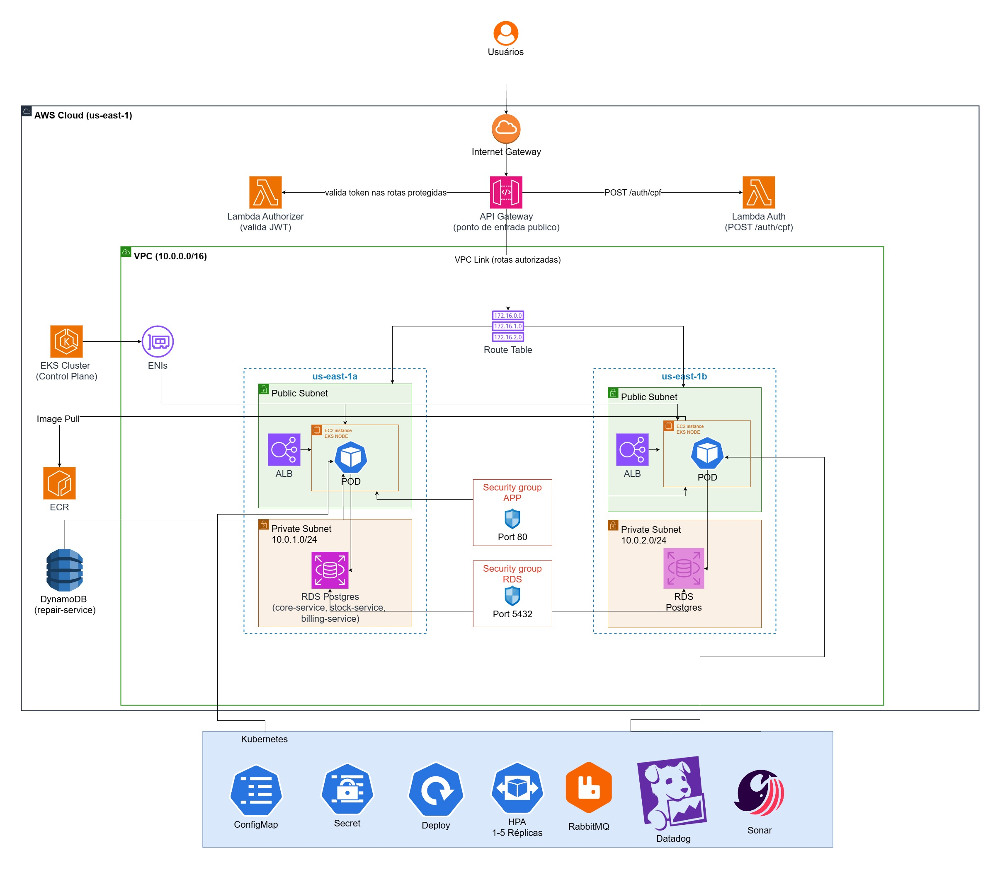

# mechanical-hub-stock-service

Microsserviço de **controle de estoque** do Mechanical Hub (Fase 4 — Tech Challenge). Dono da reserva/baixa/entrada de materiais, chamado de forma **síncrona** pelo [`repair-service`](https://github.com/estefanyneres/mechanical-hub-repair-service) e participante do Saga Pattern orquestrado pelo [`core-service`](https://github.com/estefanyneres/mechanical-hub-core-service).

## Diagrama de infraestrutura



## Arquitetura

Clean Architecture (`domain` / `application` / `infrastructure`):

- **domain** — `Stock` (quantidade disponível/reservada por material), `StockMovement` (histórico de movimentações), `StockPendingItem` (pendências de reserva por falta de estoque).
- **application** — `StockUseCase` (reserva, baixa, entrada, resolução automática de pendências), `StockPendingUseCase`, `StockMovementUseCase`.
- **infrastructure** — PostgreSQL/Flyway, segurança JWT stateless (`hasRole(ADMINISTRATOR)`, igual era no monolito), mensageria (publica, não consome routing keys do Saga diretamente — é chamado via REST síncrono).

Este serviço **não tem acesso** às entidades de `ServiceOrder`/`Material`/`OrderTask` do repair-service (ADR-001 — cada serviço só conhece o próprio banco): todos os métodos recebem só IDs e quantidades.

### Papel no Saga (via chamada síncrona, não evento direto)

1. `POST /stock/reservations` (chamado pelo repair-service após `pagamento.confirmado`) — tenta reservar cada item da lista. Item sem estoque fica pendente (`StockPendingItem`), não é tudo-ou-nada: itens com estoque já ficam reservados mesmo se outro da mesma chamada ficar pendente
2. `POST /stock/entry` (entrada de material) — soma ao estoque disponível e resolve pendências em aberto, na ordem em que foram criadas; se uma OS fica sem nenhuma pendência, publica `estoque.reabastecido` (o repair-service escuta esse evento pra tentar reservar de novo — este serviço não decide `material.reservado` diretamente, só avisa que pode tentar)
3. `POST /stock/reservations/consume` — baixa definitiva quando uma tarefa de execução é finalizada
4. `POST /stock/materials/{id}/initialize` \| `DELETE /stock/materials/{id}` — chamados pelo repair-service quando um material é criado/removido do catálogo

**Publica:** `estoque.reabastecido`
**Não consome eventos do Saga** — toda interação é via REST síncrono, chamado pelo repair-service

## Tecnologias

- Java 21 / Spring Boot 3.2
- PostgreSQL (RDS, `stock_service_db`) via Spring Data JPA + Flyway
- RabbitMQ (Spring AMQP, só pra publicar)
- Spring Security (JWT stateless, `ADMINISTRATOR`)
- Datadog (`dd-java-agent` + Micrometer/statsd)
- springdoc-openapi (Swagger UI)
- JUnit 5 + Mockito + AssertJ

## Rodando localmente

```bash
./mvnw spring-boot:run
```

Variáveis de ambiente em `k8s/configmap.yaml`/`k8s/secret.yaml` (`DB_HOST`/`DB_PORT`/`DB_NAME`, `RABBITMQ_HOST`, `JWT_SECRET`).

Swagger UI: `http://localhost:8080/swagger-ui/index.html`

## Testes

```bash
./mvnw test
```

**102 testes**, **97,9% de cobertura** (gate SonarQube: 80% em código novo). Exclusão do Sonar: só `RabbitMQConfig` (wiring puro).

## Deploy

- `Dockerfile` multi-stage (`eclipse-temurin:21-jre-jammy` + `dd-java-agent`)
- `k8s/` — namespace, configmap, secret, deployment, service (NodePort `30083`), HPA
- CI/CD: `feature.yml` (build → testes → SonarQube com gate → PR) e `main.yml` (build → push ECR → deploy EKS)

Exposto publicamente via API Gateway no path `/stock*` — necessário pra testar manualmente via Insomnia/Postman, mesmo sendo majoritariamente chamado internamente pelo repair-service.

## Documentação de arquitetura

As decisões de arquitetura compartilhadas entre os 4 microsserviços (decomposição de domínio, Saga orquestrado, RabbitMQ, DynamoDB) estão documentadas no repositório do [`core-service`](https://github.com/estefanyneres/mechanical-hub-core-service/tree/main/docs).
